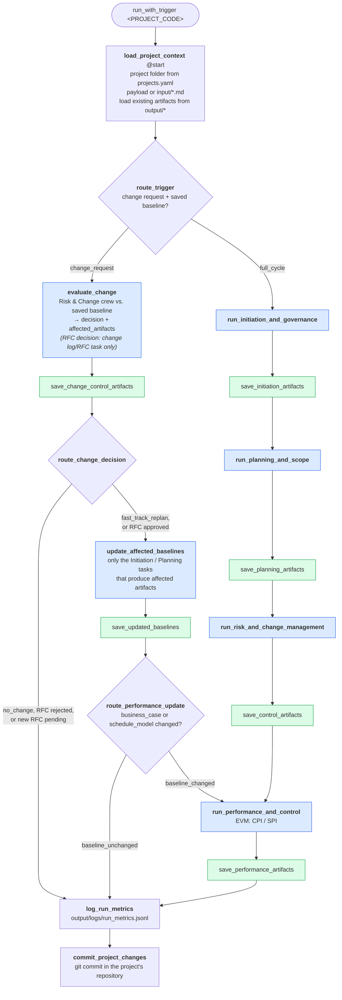

# proto-crewai-flow-project-management

Welcome to the proto-crewai-flow-project-management project, powered by [crewAI](https://crewai.com). This template is designed to help you set up a multi-agent AI system with ease, leveraging the powerful and flexible framework provided by crewAI. Our goal is to enable your agents to collaborate effectively on complex tasks, maximizing their collective intelligence and capabilities.

## Setup the project

Requeriments:

- Python 3.10+
- [Virtual Environments](https://www.w3schools.com/PYTHON/python_virtualenv.asp)
- VS Code
- [CrewAI](https://docs.crewai.com/v1.15.2/en/installation)
- LLM SDKs
- Dotenv

```bash
python3 --version
# Python 3.12.3

# Go to the project folder
# Create a virtual environment in a hidden folder .venv to isolate dependencies
python3 -m venv .venv
# This will set up a virtual environment, and create a folder named ".venv" with subfolders and files, like this:
#.venv
# Include  
# Lib  
# Scripts  
# .gitignore  
# pyvenv.cfg

# Activate the virtual environment
source .venv/bin/activate
# The command line will look like this when the virtual environment is active:
(.venv) ... $
```

Install uv python package manager <https://docs.astral.sh/uv/getting-started/installation/#installation-methods>:

```bash
# Install astral
curl -LsSf https://astral.sh/uv/install.sh | sh
uv --version

# To add $HOME/snap/code/248/.local/share/../bin to your PATH
#    gedit ~/.profile
# Either restart your shell or run:
#
#    source $HOME/snap/code/248/.local/share/../bin/env (sh, bash, zsh)
#    source $HOME/snap/code/248/.local/share/../bin/env.fish (fish)
```

Install CrewAI CLI:

```bash
uv tool install crewai

# Check crewai is installed successfully
uv tool list

# Update the shell path
uv tool update-shell

# Upgrade crewai
uv tool install crewai --upgrade
```

## Create the project

```bash
crewai create flow proto-crewai-flow-organization-analysis
```

## Install dependencies

```bash
crewai install
uv add "crewai[google-genai]"
uv add "crewai[litellm]"

uv add crewai-tools
```

## Running

Several projects can be managed at the same time. The project setup document `projects.yaml` relates each project code to the folder that holds its input and output documents:

```yaml
projects:
  PRJ-001:
    name: Sample Project
    folder: ../pm-sample-project   # absolute, or relative to projects.yaml
    input_dir: input               # relative to folder (default: input)
    output_dir: output             # relative to folder (default: output)
```

Each project folder must be inside a git repository (for example, one GitHub repository per project): at the end of every run the flow commits the documents it changed and the run metrics there, with the project code and trigger in the commit message. Only those files are committed, so other staged changes in the repository are left alone; pushing stays up to you. Set `PROJECTS_SETUP_PATH` to use a setup document stored elsewhere.

`crewai run` is disabled, because every run must name the project it works on. Run the flow from the root folder of this repository with the project code, and an optional JSON payload:

```bash
uv run run_with_trigger PRJ-001
uv run run_with_trigger PRJ-001 '{"status_date": "2026-11-01"}'
```

The project name comes from the setup document. Below, `input/` and `output/` mean the input and output folders of the project.

The flow reads the brief from `input/project_brief.md` (and optional actuals from `input/progress_data.md`), runs four crews in sequence and writes their artifacts under `output/`:

| Crew | Artifacts |
|------|-----------|
| Initiation and Governance | `output/initiation/` — business case, project charter, stakeholder register, team charter |
| Planning and Scope | `output/planning/` — WBS, backlog, schedule model, requirements specification, definition of done |
| Risk and Change Management | `output/control/` — risk register, change log, and one `rfcs/RFC-<NNN>.md` per change request that breaches a tolerance, with their status in `rfc_register.json` |
| Performance and Control | `output/performance/` — EVM metrics, S-curve CSV, project dashboard, status report |

Each run appends its KPIs (flow duration, per-crew latency, per-task time and output size, tasks completed, token usage) to `output/logs/run_metrics.jsonl`. Existing artifacts in `output/` are fed back to the crews on the next run so they update rather than start over.

### First run

To try it, add the project to `projects.yaml`, write a brief into the project's `input/project_brief.md` and run `uv run run_with_trigger PRJ-001`, or pass the brief in the payload:
uv run run_with_trigger PRJ-001 `'{"project_brief": "...", "trigger_reason": "Project inception"}'`

After the first full run, crewai traces enable will record each step of the run if you want to see how the agents reached their output.

### Change requests

Once a baseline exists in `output/`, a run with a `scope_change_request` doesn't regenerate everything. The Risk and Change Management crew first evaluates the change against the saved baseline and lists the affected artifacts; then only those documents are updated:

```bash
uv run run_with_trigger PRJ-001 '{"scope_change_request": "Add SSO login to the customer portal"}'
```

For a longer request, write it to a file in `input/` and pass its name instead (the two keys can't be combined):

```bash
uv run run_with_trigger PRJ-001 '{"scope_change_request_file": "20261024-rfc-01.md"}'
```

- **No change** (`no_change`): only the risk register and change log are updated.
- **Fast-track replan** (`fast_track_replan`, within tolerance: critical path delay ≤ 3 days and cost delta ≤ 5%): the affected initiation and planning documents are updated, and the EVM metrics, dashboard and status report are recalculated only if the cost or schedule baseline changed.
- **Formal RFC** (`formal_rfc`, tolerance breached): the risk register and change log are updated, the RFC is written to `output/control/rfcs/RFC-<NNN>.md` with the next free ID, and the baselines stay unchanged. The run prints the RFC ID, and `output/control/rfc_register.json` tracks each RFC's status (`pending`, `approved`, `rejected`), so several RFCs can be pending at the same time.

Once the Change Control Board decides, run the flow again with the RFC ID (`2`, `002` and `RFC-002` are equivalent):

```bash
# Approve: records the approval, then updates only the affected documents
uv run run_with_trigger PRJ-001 '{"rfc_identifier": "RFC-002", "rfc_approved": true}'
# Reject: records the rejection in the change log and RFC; the baselines stay unchanged
uv run run_with_trigger PRJ-001 '{"rfc_identifier": "RFC-002", "rfc_approved": false}'
```

A decision run takes the change from the RFC register, so it doesn't accept `scope_change_request`. Only a pending RFC can be decided, and `rfc_approved` without `rfc_identifier` is refused with the list of pending RFCs. Unchanged documents are never rewritten, and each run logs its `change_decision`, `rfc_identifier`, `rfc_decision`, `affected_artifacts` and `saved_files` in `output/logs/run_metrics.jsonl`.

## Project Structure

**Add your `OPENAI_API_KEY` into the `.env` file**

- Each crew lives in `src/project_management/crews/<crew_name>/`, with its agents and tasks in `config/agents.yaml` and `config/tasks.yaml` and its logic in `<crew_name>.py`
- `src/project_management/main.py` orchestrates the flow and saves the artifacts
- `src/project_management/project_setup.py` looks up a project code in `projects.yaml` and commits each run's changes in the project's repository
- `src/project_management/metrics.py` times crews and tasks and collects the run KPIs
- `src/project_management/task_selection.py` lets a crew run only the tasks whose artifacts a change affects

### Flow diagram

Version v0.3.0



## How to create a CrewAI project

Steps done to create this project.

Iteration 1 - Crew creation. Steps:

1. Identify the general architecture: how may crews it will be needed, what will do each crew and a name
2. Specify each crew:
    2.1. Specify the agents: name, role and a description
    2.2. Specify the tasks: name, description, generated artifacts and agent that will execute the task
3. Specify the flow orchestration patter to be used
4. Test running `crewai run` and inspect and analyze the logs and the artifacts generated

Iteration 2 - KPI and logs to measure performance and reliability. Steps:

1. Identify the KPI and values to measure
2. Add the KPIs and log the results

## Roadmap

- Add risk database, with a project type that can be used by LLM to identify if it can be applied to the current project, to build a more real world project roisk identification.

## Changelog

### v0.3.0 — 2026-10-17

**Added**
- Several projects can be managed at the same time: the project setup document `projects.yaml` relates each project code to a folder holding its input and output documents (`PROJECTS_SETUP_PATH` points to a setup document stored elsewhere).
- At the end of each run, the documents it changed and its run metrics are committed in the project's git repository, with the project code, trigger and decisions in the commit message. Other staged changes there are left alone.

**Changed**
- `uv run run_with_trigger <PROJECT_CODE> [<json payload>]` takes the project code as its first argument; the payload is optional, and the project name comes from the setup document instead of `project_name`.
- The brief, progress data, change request files, artifacts, RFCs and run metrics are read from and written to the project's folders instead of this repository's `input/` and `output/`.
- `crewai run` is disabled and points to `run_with_trigger`, since every run must name its project.

### v0.2.0 — 2026-10-17

**Added**
- Change requests no longer regenerate every document. Once a baseline exists, the Risk and Change Management crew evaluates the change against it first, and only the affected documents are updated; EVM metrics, dashboard and status report are recalculated only when the cost or schedule baseline changes.
- Formal RFCs get a unique ID (`RFC-001`, `RFC-002`, …), are saved as `output/control/rfcs/RFC-<NNN>.md`, and are tracked in `output/control/rfc_register.json`, so several RFCs can be pending at the same time.
- Approve or reject a pending RFC with a second run: `{"rfc_identifier": "RFC-002", "rfc_approved": true}` (or `false`). Approval applies the change; rejection records it and leaves the baselines unchanged.
- The change request can be read from a file in `input/` with `"scope_change_request_file": "<name>.md"`.
- The run log records the change decision, RFC ID and decision, affected artifacts, and the files saved in each run.

**Changed**
- Documents whose content hasn't changed are no longer rewritten.
- The single `output/control/change_request_RFC.md` is replaced by one file per RFC under `output/control/rfcs/`.

### v0.1.0 — 2026-10-16

**Added**
- Project-management flow that turns a project brief into a full set of PM artifacts using four crews: Initiation and Governance, Planning and Scope, Risk and Change Management, and Performance and Control.
- Input from `input/project_brief.md` or a trigger payload (`uv run run_with_trigger '<json>'`), with optional scope change requests, emerging conditions and progress data.
- Incremental runs: artifacts already in `output/` are passed back to the crews so they are updated instead of regenerated.
- Run KPIs (flow duration, crew latency, per-task time and word count, tasks completed, token usage) printed at the end of each run and appended to `output/logs/run_metrics.jsonl`.
